<!-- The card below is generated from config.json by https://github.com/GiuseppeBellamacina/profile-forge (.github/workflows/profile-forge.yml). Edit config.json (or use the web configurator), not the card. -->
<!-- profile-forge:start -->
<picture>
  <source media="(prefers-color-scheme: dark)" srcset="assets/profile-forge-dark.svg">
  
</picture>
<!-- profile-forge:end -->
